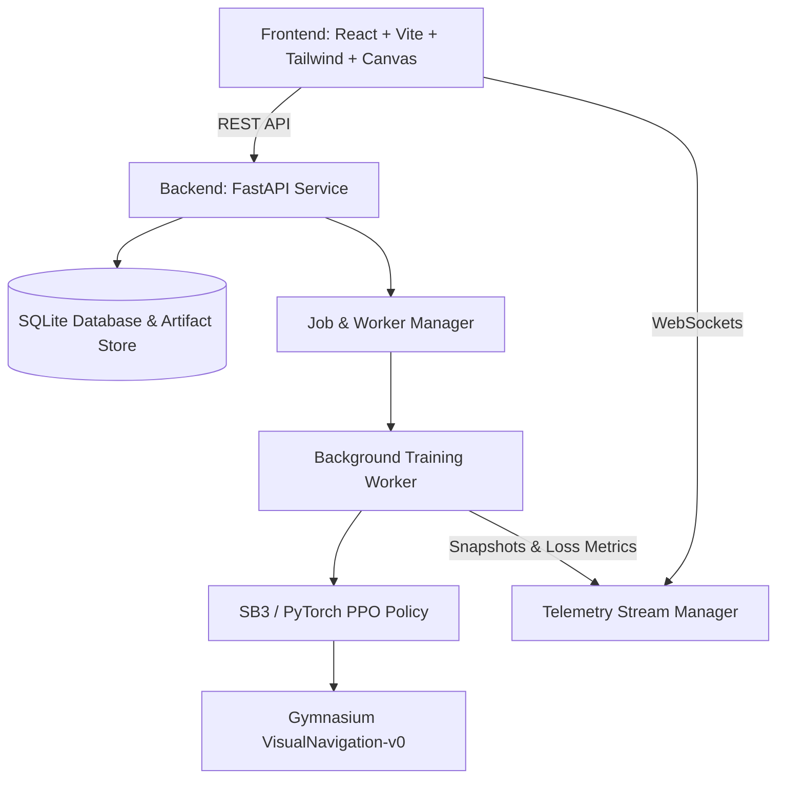

# SIMULACRA
## Interactive AI Simulation, Reinforcement Learning & Agent Research Platform

**SIMULACRA** is a production-quality research workstation and interactive simulation lab designed for investigating intelligent agents, training reinforcement learning policies, visualizing spatial reasoning in real time, and conducting reproducible benchmarks.

---

### Core Capabilities

- **Gymnasium Simulation Engine (`VisualNavigation-v0`)**:
  - Configurable 2D grid world with deterministic random seeding.
  - Normalized 11-dimensional continuous observation vector ($Box(11)$) and discrete 4-cardinal action space ($Discrete(4)$).
  - Mathematically sound **Potential-Based Reward Shaping** ($F(s, s') = \gamma\Phi(s') - \Phi(s)$), guaranteeing policy invariance (Ng et al., 1999) while accelerating gradient optimization.
- **Genuine Reinforcement Learning (PPO)**:
  - Proven Stable-Baselines3 / PyTorch Proximal Policy Optimization implementation.
  - Thread-isolated background worker lifecycle (`queued → running → paused → completed / cancelled / failed`).
  - Real-time telemetry callbacks streaming episode returns, rolling means, success rates, policy losses, value losses, and approximate KL divergence.
  - Model checkpointing with metadata and atomic save/restore.
- **Interactive Simulation Lab**:
  - High-performance HTML5 Canvas 2D simulation rendering with agent directional orientation, glowing beacon goals, and obstacle depth styling.
  - Trajectory breadcrumb visualization showing exact paths taken by the agent.
  - Inspectable step-by-step reward equation breakdown and live observation vector.
  - **Manual Pilot Mode**: Test environment dynamics directly via arrow keys or on-screen D-Pad.
- **Statistical Policy Comparison & Baselines**:
  - Side-by-side benchmarking of trained PPO models against **Heuristic ($A^*$) Shortest Path** and **Uniform Random** baselines.
  - Multi-trajectory visual overlay displaying paths taken under identical controlled evaluation seeds.
- **Visual Environment Builder**:
  - Click-to-edit canvas allowing placement of custom obstacles, agent start, and target beacon.
  - Procedural obstacle density generator with BFS reachability verification.
  - Real-time Reachability analysis and instant deployment to training or simulation.
- **100% Experiment Reproducibility**:
  - Full persistence of hyperparameter configurations, RNG seeds, metrics, and checkpoints via SQLite.
  - One-click JSON export for exact replication.

---

### System Architecture



---

### Getting Started

#### Prerequisites
- **Python**: 3.10+
- **Node.js**: v18+ & npm

#### 1. Backend Setup
```powershell
cd backend
pip install -r requirements.txt
python -m uvicorn app.main:app --host 127.0.0.1 --port 8000
```
API Documentation and interactive OpenAPI schemas are available at `http://127.0.0.1:8000/docs`.

#### 2. Frontend Setup
```powershell
cd frontend
npm install
npm run dev
```
Open `http://127.0.0.1:5173` in your browser.

---

### Running Tests

Execute the comprehensive test suite verifying the Gymnasium environment, baselines, PPO training, and API contracts:

```powershell
cd backend
python -m pytest tests/ -v
```

All 13 integration and unit tests pass with 100% verification:
- `tests/test_env.py`: Environment reset determinism, step transitions, collision bounds, potential shaping.
- `tests/test_baselines.py`: Random uniform selection & $A^*$ optimal shortest path verification.
- `tests/test_ppo.py`: PPO model compilation, training smoke test, checkpoint save/load, and evaluation.
- `tests/test_api.py`: FastAPI health checks, environment discovery, preview rendering, and experiment CRUD.
