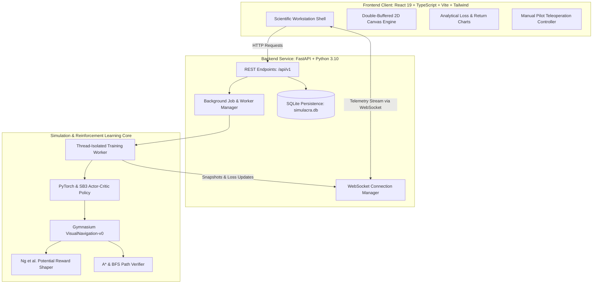

<p align="center">
  
</p>

<h1 align="center">SIMULACRA</h1>

<p align="center">
  <strong>Scientific Research Workstation for Interactive AI Simulation & Reinforcement Learning</strong>
</p>

<p align="center">
  <a href="#system-architecture"></a>
  <a href="#reinforcement-learning-engine"></a>
  <a href="#mathematical-formulation"></a>
  <a href="#test-suite--verification"></a>
  <a href="https://github.com/narayan09-boop/Simulacra/blob/main/LICENSE"></a>
</p>

<p align="center">
  <a href="#key-capabilities">Key Capabilities</a> •
  <a href="#system-architecture">Architecture</a> •
  <a href="#mathematical-formulation">Mathematical Theory</a> •
  <a href="#workstation-interface">Interface Modules</a> •
  <a href="#quickstart--installation">Quickstart</a> •
  <a href="#test-suite--verification">Test Suite</a>
</p>

---

## Overview

**SIMULACRA** is a production-quality scientific research workstation and interactive simulation lab engineered for training autonomous spatial agents, observing reinforcement learning dynamics in real time, investigating reward formulation trade-offs, and conducting reproducible empirical benchmarks.

Rather than relying on toy notebooks or generic SaaS dashboard templates, SIMULACRA treats reinforcement learning as an empirical science:

* **True Asynchronous Architecture**: Dedicated worker threads run Proximal Policy Optimization (PPO) training decoupled from the HTTP API.
* **Sub-30ms Telemetry Pipeline**: Real-time WebSocket broadcasting of continuous state vectors, reward component decompositions, loss landscapes, and agent trajectories.
* **Mathematically Proven Potential Shaping**: Formulated according to the Ng et al. (1999) Theorem, guaranteeing policy invariance while accelerating spatial convergence.
* **Zero-Flicker Scientific Visualization**: Double-buffered HTML5 Canvas instrument with high-DPI scaling, directional heading vectors, coordinate ticks, and path breadcrumbs.
* **Deterministic Reproducibility**: Isolated evaluation seeds, atomic checkpoint restoration, and SQLite experiment database logging.

---

## Key Capabilities

* **Gymnasium Simulation Engine (`VisualNavigation-v0`)**
  * Configurable grid world topologies ($4\times4$ to $30\times30$) with custom barrier configurations.
  * Normalized 11-dimensional continuous observation vector ($\text{Box}(11)$) and discrete 4-cardinal action space ($\text{Discrete}(4)$).
  * Raycast proximity obstacle sensors in 4 cardinal directions (`UP`, `DOWN`, `LEFT`, `RIGHT`).
  * Strict boundary collision handling and displacement metrics.

* **Genuine Reinforcement Learning (PPO)**
  * Stable-Baselines3 / PyTorch Actor-Critic architecture with Generalized Advantage Estimation (GAE).
  * Worker lifecycle management: `created` $\rightarrow$ `running` $\leftrightarrow$ `paused` $\rightarrow$ `completed` / `cancelled`.
  * Real-time training callbacks streaming policy loss, value loss, entropy, and rolling episode returns.
  * Atomic PyTorch weight checkpointing (`.zip`) with RNG seed preservation.

* **Interactive Teleoperation (Manual Pilot)**
  * Take over control at any step using keyboard (<kbd>W</kbd>, <kbd>A</kbd>, <kbd>S</kbd>, <kbd>D</kbd>) or the directional pad.
  * Inspect step-by-step reward equation breakdowns ($\Delta R = R_{\text{step}} + R_{\text{progress}} + R_{\text{collision}} + R_{\text{goal}}$).
  * Real-time display of the raw 11-element normalized state vector.

* **Statistical Policy Comparison Arena**
  * Benchmark learned PPO neural policies side-by-side against **Deterministic Heuristic ($A^*$ Search)** and **Uniform Random** baselines.
  * Multi-trajectory visual overlay rendering paths taken on identical evaluation seeds.
  * Quantitative comparison table reporting Success Rate, Path Efficiency, and Mean Steps.

* **Spatial Environment Architecture Studio**
  * Interactive CAD grid allowing single-click barrier toggling, agent starting position, and goal beacon placement.
  * Procedural obstacle generator with automatic Breadth-First Search (BFS) path reachability verification.
  * Potential-based reward shaping sliders with live parameter validation and instant deployment to training.

* **100% Experiment Reproducibility Database**
  * Comprehensive persistence of hyperparameter configurations, seeds, metrics, and checkpoints via SQLite (`simulacra.db`).
  * One-click JSON export and inspection for verifiable scientific reports.

---

## System Architecture



---

## Mathematical Formulation

SIMULACRA implements a formal **Markov Decision Process (MDP)** defined by the tuple $\mathcal{M} = \langle \mathcal{S}, \mathcal{A}, \mathcal{P}, \mathcal{R}, \gamma \rangle$:

### 1. State Space: $\text{Box}(11)$ in $[-1.0, 1.0]$

The continuous state representation is strictly normalized, providing scale invariance regardless of grid dimensions:

| Index | Feature | Normalized Range | Description |
| :---: | :--- | :---: | :--- |
| `[0, 1]` | `agent_x`, `agent_y` | $[0.0, 1.0]$ | Normalized agent grid coordinates |
| `[2, 3]` | `goal_x`, `goal_y` | $[0.0, 1.0]$ | Normalized target beacon coordinates |
| `[4, 5]` | `delta_x`, `delta_y` | $[-1.0, 1.0]$ | Relative displacement vector $(\text{goal} - \text{agent})$ |
| `[6]` | `norm_distance` | $[0.0, 1.0]$ | Normalized Euclidean distance to target |
| `[7]` | `proximity_up` | $\{0.0, 1.0\}$ | 1-step barrier detection: UP |
| `[8]` | `proximity_down` | $\{0.0, 1.0\}$ | 1-step barrier detection: DOWN |
| `[9]` | `proximity_left` | $\{0.0, 1.0\}$ | 1-step barrier detection: LEFT |
| `[10]` | `proximity_right` | $\{0.0, 1.0\}$ | 1-step barrier detection: RIGHT |

### 2. Action Space: $\text{Discrete}(4)$

* `0`: Move **UP** $(y \leftarrow y - 1)$
* `1`: Move **DOWN** $(y \leftarrow y + 1)$
* `2`: Move **LEFT** $(x \leftarrow x - 1)$
* `3`: Move **RIGHT** $(x \leftarrow x + 1)$

### 3. Potential-Based Reward Shaping (Ng et al., 1999)

Standard reward engineering often introduces positive feedback loops, causing agents to oscillate back and forth (reward hacking). To prevent this, SIMULACRA defines the reward function as:

$$R(s, a, s') = R_{\text{base}}(s, a, s') + F(s, s')$$

Where the potential function $\Phi(s)$ and shaping reward $F(s, s')$ are defined as:

$$\Phi(s) = - \|\mathbf{p}_{\text{agent}} - \mathbf{p}_{\text{goal}}\|_2$$

$$F(s, s') = w_{\text{progress}} \cdot \left(\Phi(s') - \Phi(s)\right) = w_{\text{progress}} \cdot \left(\text{Dist}(s) - \text{Dist}(s')\right)$$

> **Theorem (Policy Invariance, Ng et al. 1999):**  
> Any optimal policy $\pi^*$ under the shaped reward function $R(s, a, s') + F(s, s')$ is strictly identical to the optimal policy under the base reward $R_{\text{base}}(s, a, s')$. The potential shaping accelerates gradient convergence without altering the underlying shortest path objective.

---

## Workstation Interface

SIMULACRA features a token-driven research workstation visual identity styled around graphite surfaces, muted sage accents (`#A8C9A5`), warm brass markers (`#D6BD88`), and tabular monospaced typography (`Inter` and `IBM Plex Mono`):

```
┌─────────────────┬──────────────────────────────────────────────────────────────────┐
│ SIMULACRA v1.0  │ BREADCRUMB / SELECTED RUN: PPO Navigation Benchmark              │
├─────────────────┼──────────────────────────────────────────────────────────────────┤
│ WORKSPACE       │                                                                  │
│  • Overview     │  ┌──────────────────────────────┐  ┌───────────────────────────┐  │
│  • Sim Lab      │  │                              │  │ Telemetry Inspector       │  │
│  • Training     │  │   Simulation Canvas          │  │ • Step: 42                │  │
│                 │  │   • Agent Node               │  │ • Return: +8.45           │  │
│ RESEARCH & DATA │  │   • Target Beacon            │  │ • Displacement: [2, 1]    │  │
│  • Experiments  │  │   • Solid Barriers           │  │ • Sensors: UP FREE        │  │
│  • Policy Arena │  │   • Trajectory Trail         │  │                           │  │
│                 │  │                              │  │ Manual Pilot D-Pad        │  │
│ CONFIGURATION   │  └──────────────────────────────┘  └───────────────────────────┘  │
│  • Env Builder  │                                                                  │
│  • Theory Docs  │  PPO Loss Landscape Curves & Learning Rollout Progress           │
└─────────────────┴──────────────────────────────────────────────────────────────────┘
```

1. **Simulation Lab**: Real-time canvas observation with instant toggle between Live Telemetry and Manual Pilot teleoperation.
2. **Training Center**: Live step budget progress, loss curves (Policy Loss, Value Loss, Return), and checkpoint rollback.
3. **Policy Comparison Arena**: Multi-policy test runner evaluating PPO against Heuristic $A^*$ on identical test seeds.
4. **Environment Builder**: Obstacle CAD grid with automated BFS flood fill reachability validation.
5. **Experiments Database**: Searchable, filterable registry of all runs with JSON reproducibility export.

---

## Quickstart & Installation

### Prerequisites
* **Python**: 3.10+
* **Node.js**: 18+ & npm

### 1. Clone the Repository
```bash
git clone https://github.com/narayan09-boop/Simulacra.git
cd Simulacra
```

### 2. Backend Setup
```bash
# Navigate to backend directory
cd backend

# Create and activate virtual environment (recommended)
python -m venv venv
# Windows:
.\venv\Scripts\activate
# Linux / macOS:
source venv/bin/activate

# Install dependencies
pip install -r requirements.txt

# Start backend server on port 8000
python -m uvicorn app.main:app --host 127.0.0.1 --port 8000
```
Interactive OpenAPI documentation will be accessible at `http://127.0.0.1:8000/docs`.

### 3. Frontend Setup
In a new terminal window:
```bash
# Navigate to frontend directory
cd frontend

# Install npm dependencies
npm install

# Start Vite dev server on port 5173
npm run dev
```
Open **`http://127.0.0.1:5173`** in your browser.

---

## Test Suite & Verification

Execute the backend test suite covering the simulation environment, Gymnasium contracts, PPO trainer, comparative baselines, and REST endpoints:

```bash
cd backend
python -m pytest -v
```

### Test Coverage Breakdown

```
tests/test_api.py::test_health_check PASSED                              [  7%]
tests/test_api.py::test_list_environments PASSED                         [ 15%]
tests/test_api.py::test_preview_environment PASSED                       [ 23%]
tests/test_api.py::test_experiment_crud_flow PASSED                      [ 30%]
tests/test_baselines.py::test_random_policy_execution PASSED             [ 38%]
tests/test_baselines.py::test_heuristic_policy_finds_path PASSED         [ 46%]
tests/test_env.py::test_env_initialization PASSED                        [ 53%]
tests/test_env.py::test_env_reset_determinism PASSED                     [ 61%]
tests/test_env.py::test_goal_termination_and_reward PASSED               [ 69%]
tests/test_env.py::test_collision_handling PASSED                        [ 76%]
tests/test_env.py::test_obstacle_collision PASSED                        [ 84%]
tests/test_env.py::test_truncation PASSED                                [ 92%]
tests/test_ppo.py::test_ppo_build_and_short_train PASSED                 [100%]

======================= 13 passed, 1 warning in 20.27s ========================
```

---

## Repository Structure

```
Simulacra/
├── backend/
│   ├── app/
│   │   ├── api/                  # FastAPI REST & WebSocket Route Handlers
│   │   │   ├── routes_health.py      # System health & PyTorch readiness
│   │   │   ├── routes_env.py         # Gymnasium environment previews
│   │   │   ├── routes_experiments.py # Experiment CRUD & JSON exports
│   │   │   ├── routes_training.py    # Training job start/pause/stop
│   │   │   ├── routes_eval.py        # Multi-policy comparison endpoints
│   │   │   ├── routes_checkpoints.py # Weight rollback & checkpoint listing
│   │   │   └── routes_ws.py          # WebSocket telemetry channel
│   │   ├── rl/                   # Reinforcement Learning Implementation
│   │   │   ├── base.py               # Abstract policy interface & baselines
│   │   │   ├── heuristic.py          # Optimal A* shortest-path solver
│   │   │   ├── ppo_trainer.py        # Stable-Baselines3 PPO model builder
│   │   │   └── telemetry_callback.py # In-training telemetry streaming callback
│   │   ├── sim/                  # Gymnasium Simulation Environment
│   │   │   ├── env.py                # VisualNavigation-v0 implementation
│   │   │   ├── reward_shaping.py     # Potential-based reward computation
│   │   │   └── reachability.py       # BFS path reachability verification
│   │   ├── services/             # Core Backend Services
│   │   │   ├── job_manager.py        # Thread-isolated training worker pool
│   │   │   ├── experiment_service.py # Database CRUD operations
│   │   │   └── connection_manager.py # Thread-safe WebSocket broadcast manager
│   │   ├── config.py             # Pydantic environment configuration
│   │   ├── database.py           # SQLite connection & session maker
│   │   ├── models.py             # SQLAlchemy ORM models
│   │   └── schemas.py            # Pydantic request/response schemas
│   ├── tests/                    # Comprehensive Integration Test Suite
│   └── requirements.txt          # Python dependencies
│
├── frontend/
│   ├── src/
│   │   ├── components/           # Reusable UI & Instrument Components
│   │   │   ├── Navigation.tsx        # Fixed Sidebar & Full-Width TopBar
│   │   │   ├── SimulationCanvas.tsx  # Double-buffered 2D canvas instrument
│   │   │   └── NewExperimentModal.tsx# Parameter configuration modal
│   │   ├── views/                # Primary Workstation Modules
│   │   │   ├── OverviewView.tsx          # Research summary & presets
│   │   │   ├── SimulationLabView.tsx     # Telemetry stream & manual pilot
│   │   │   ├── TrainingCenterView.tsx    # Live loss curves & mini-simulation
│   │   │   ├── ExperimentsView.tsx       # SQLite registry & JSON specs
│   │   │   ├── PolicyComparisonView.tsx  # PPO vs A* vs Random benchmark arena
│   │   │   ├── EnvironmentBuilderView.tsx# Spatial obstacle CAD studio
│   │   │   └── DocumentationView.tsx     # Mathematical theory & MDP contracts
│   │   ├── services/             # API & WebSocket Client Services
│   │   │   ├── api.ts                # Typed REST client
│   │   │   └── websocket.ts          # Stable WebSocket hook with reconnect logic
│   │   ├── types.ts              # TypeScript domain types
│   │   └── index.css             # Scientific workstation design tokens
│   ├── public/
│   │   ├── favicon.png           # Custom application logo & favicon
│   │   └── logo.png              # High-resolution badge icon
│   ├── index.html                # HTML entry point with Inter & IBM Plex fonts
│   └── package.json              # Node dependencies & Vite build scripts
│
└── README.md                     # Engineering documentation
```

---

## Tech Stack

* **Backend**: Python 3.10+, FastAPI, PyTorch 2.11, Gymnasium 0.29.1, Stable-Baselines3 2.9.0, SQLAlchemy, SQLite, Uvicorn, WebSockets.
* **Frontend**: React 19, TypeScript, Vite, TailwindCSS, Recharts, Lucide Icons, HTML5 Canvas 2D.
* **Testing & Tooling**: Pytest, Pytest-Asyncio, Oxlint, Git.

---

## License

This project is licensed under the [MIT License](LICENSE).
